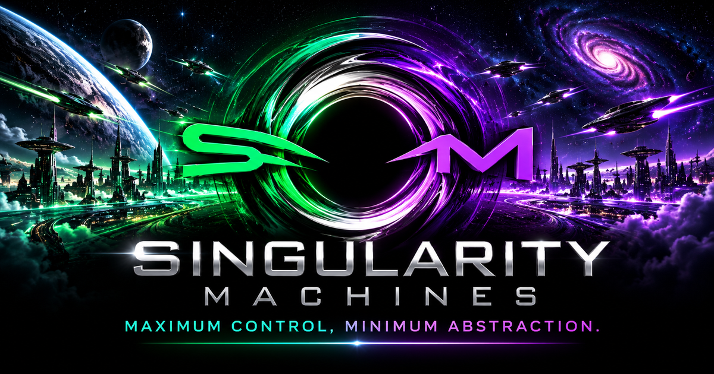

# Singularity Machines

<!-- README V2 VISUAL HEADER -->

  

  <a href="https://singularitymachines.si/">Official Website</a> ·
  <a href="https://singularitymachines.si/#projects">Project Explorer</a> ·
  <a href="https://github.com/ThirDecade2020?tab=repositories">GitHub Repositories</a>

<!-- END README V2 VISUAL HEADER -->

**Maximum Control, Minimum Abstraction.**

The official website of **Singularity Machines**, a technology company specializing in software engineering, AI agentic automation, and sovereign computing systems.

**Official Website:** https://singularitymachines.si/

## About Us

Singularity Machines develops powerful, adaptable software and computing systems with an emphasis on technical control, efficiency, and minimal abstraction.

Our guiding philosophy is simple:

**Maximum Control, Minimum Abstraction.**

## Our Services

- **Fast App Creation**
- **Rapid Software Services in Any Tech Stack**
- **AI Agentic Automation**
- **Sovereign Compute Systems**
- **Local & Cloud-based Development**

## Website Overview

The Singularity Machines website is a lightweight, responsive, single-page experience built with native browser technologies.

### Sections

1. **Home** — Company branding and singularity-inspired visual identity
2. **Services** — Technical capabilities and offerings
3. **Projects** — Software and computing initiatives
4. **About** — Company philosophy and mission
5. **Contact** — Business inquiries and communication

## Project Explorer V1

Our live portfolio showcases **12 featured projects** and a
**searchable directory of 44 public GitHub repositories**.

The directory includes expandable listings, direct repository links,
and responsive layouts for desktop and mobile.

**[Explore our projects →](https://singularitymachines.si/#projects)**

The repository inventory reflects the October 19, 2026 release.

## Technology Stack

| Component | Technology |
| --- | --- |
| Structure | HTML5 |
| Styling | CSS3 |
| Interactivity | Vanilla JavaScript |
| Graphics | Canvas 2D |
| Animation | CSS and JavaScript |
| Hosting | Cloudflare Pages |
| Repository | GitHub |
| Publishing | GitHub REST API |

### Architecture

The website intentionally avoids unnecessary frameworks and build systems.

Its architecture includes:

- One primary HTML entry point
- Embedded CSS and JavaScript
- Native browser animation systems
- Locally managed image assets
- Static website hosting
- Direct API-based publishing

This architecture reflects our philosophy of maintaining direct control over the software we create.

## Visual Identity

### Colors

- **Black** — Primary background
- **Green** — Primary energy and accent color
- **Purple** — Secondary energy and accent color
- **Chrome Silver** — Metallic typography and branding

### Design Inspiration

The website draws inspiration from black holes, gravitational fields, advanced computing, particle physics, and futuristic interfaces.

## Interactive Features

### Singularity Background

- Green-purple singularity vortex
- Gravitational energy pulse
- Atmospheric background animation

### Particle Systems

- Animated particle fields
- Cursor-responsive gravitational attraction
- Dynamic energy constellations
- Particle connection lines

### Cursor Effects

- Gravitational lens
- Plasma energy trail
- Cursor-responsive illumination

### Navigation

- Floating glass-style navigation
- Magnetic navigation glow
- Navigation energy surge
- Smooth section scrolling
- Scroll progress indicator
- Return-to-top control

### Section Animations

- Holographic chrome headings
- Cinematic section activation
- Scroll-triggered reveals
- Animated neon card borders
- Interactive hover effects

### Accessibility

Reduced-motion accommodations are included for supported animations.

Additional accessibility and performance testing are planned.

## Project Structure

    SingularityMachinesWebsite/
    ├── index.html
    ├── README.md
    ├── assets/
    │   └── images/
    │       ├── brand-profile.png
    │       ├── brand-reference.png
    │       └── singularity-vortex-background.png
    └── milestones/    (local backups)

The milestones directory is maintained locally and is not required for production hosting.

## Running Locally

No frontend framework or build process is required.

From the website directory, run:

    python3 -m http.server 8000

Then open:

http://localhost:8000/

Alternatively, open `index.html` directly in a browser.

## Development Workflow

Our development process follows a local-first approach:

1. Modify source files locally.
2. Preview changes in a browser.
3. Test visual and interactive behavior.
4. Create timestamped local backups.
5. Publish approved files to GitHub using the REST API.
6. Verify the Cloudflare Pages deployment.

**The Git command-line interface is not required.**

## Development Milestones

### Project Explorer V1 — October 19, 2026

- 12 featured projects
- 44 searchable public GitHub repositories
- Expand/collapse repository directory
- GitHub contact integration
- Responsive desktop and mobile presentation
- Production verified on both domains

**Published commit:** `ecf18fac0061b98e4efe1b88879dfd3397f71c94`

### Social Preview and Performance — October 2026

- Added branded 1200 × 630 social-preview artwork
- Added Open Graph and Twitter preview metadata
- Optimized the hero image with WebP
- Preserved the original branding assets
- Improved compatibility with Cloudflare email protection

### Visual Milestone V1 — October 18, 2026

Completed features include:

- Official Singularity Machines branding
- Singularity vortex background
- Animated particles
- Gravitational cursor effects
- Plasma cursor trail
- Holographic headings
- Animated navigation
- Energy constellations
- Scroll progress indicator
- Return-to-top navigation

**Published commit:** `fa38aea7fb19`

Local milestone backups preserve previous development states.

## Deployment

The website is hosted on **Cloudflare Pages** and published
through GitHub.

**Official Live Website:** https://singularitymachines.si/

**Cloudflare Pages Domain:** https://singularitymachineswebsite.pages.dev/

**GitHub Repository:**
https://github.com/ThirDecade2020/SingularityMachinesWebsite

The custom domain is active and serves the production website.

## Engineering Philosophy

### Maximum Control, Minimum Abstraction.

Our engineering approach prioritizes:

- Direct control over source code
- Minimal unnecessary dependencies
- Lightweight application architecture
- Local-first development
- Efficient resource utilization
- Transparent system behavior
- Maintainable implementations

## Future Development

Planned improvements include:

- Continued visual enhancements
- Mobile responsiveness testing
- Cross-browser compatibility testing
- Accessibility refinements
- Animation performance optimization
- Expanded project documentation

## Contact

Visit the official website for company information and inquiries:

https://singularitymachines.si/

---

**Singularity Machines**

*Maximum Control, Minimum Abstraction.*

© 2026 Singularity Machines.
